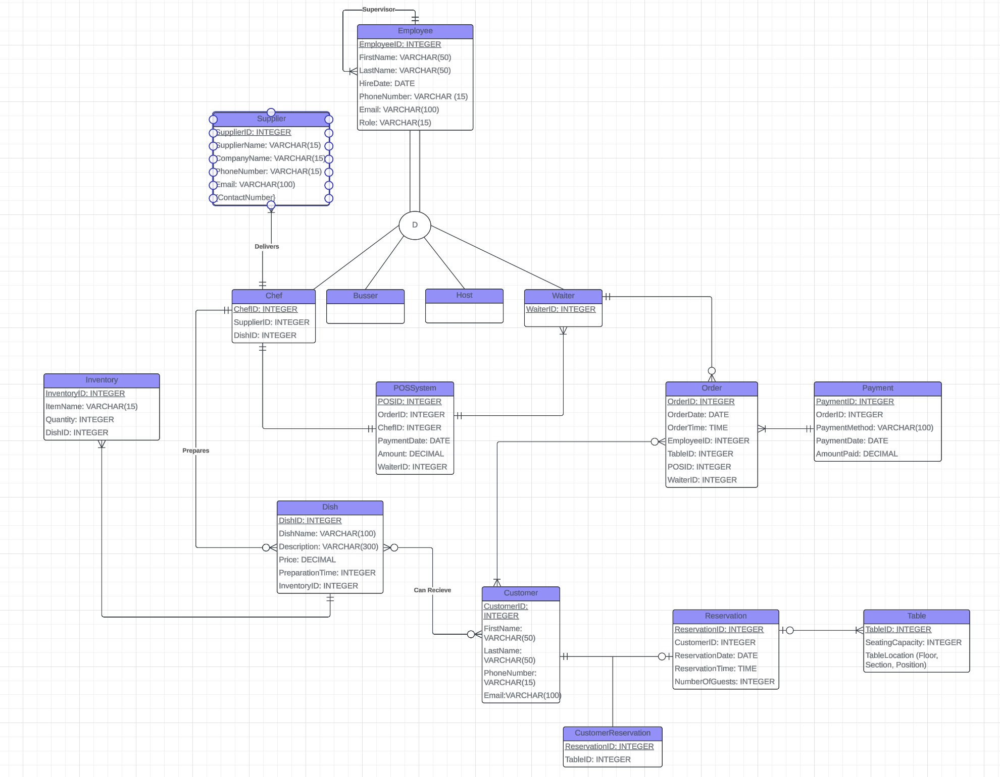
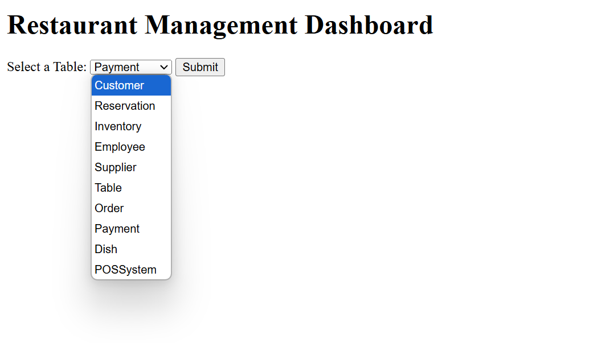
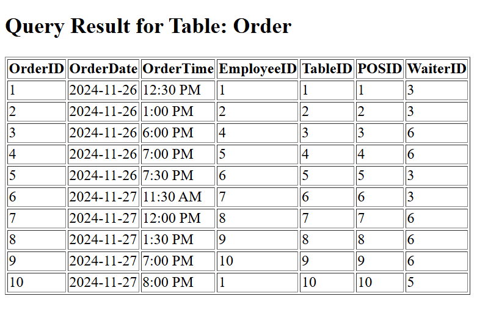

# Restaurant Management Database

A 10-table SQLite database for a restaurant (customers, reservations, tables, orders, payments, staff, dishes, inventory, suppliers and a POS system), with 100 rows of sample data and 20 SQL reports.

Group project for MIS 380 (Data Management Systems) at San Diego State University, Fall 2024, with teammates Nathan, Jason, Ian and Daniel. I did most of the database and SQL work.

## What's here

| File | What it is |
|---|---|
| `sql/01_schema_and_data.sql` | The original SQLiteStudio export: 10 tables, 100 rows |
| `sql/02_indexes.sql` | 5 indexes for common lookups (corrected in 2026, see below) |
| `sql/03_reports.sql` | The 20 report queries |
| `build_db.py` | Builds `restaurant.db` and prints every report |
| `restaurant.db` | The built database |
| `images/` | ERD and dashboard screenshots |

## ERD



## The 20 reports

They cover LIKE, aggregate functions, aliases, IN, BETWEEN, AND/OR, comparison operators, GROUP BY, HAVING, non-correlated and correlated subqueries, EXISTS, inner joins across 2 and 3 tables, a left outer join, an equi join, a self-join and UNION. A few results:

| Report | Result |
|---|---|
| Total revenue from all payments | $314.40 |
| Payment methods with more than $100 in total | Cash ($114.46), Debit Card ($105.98) |
| Lowest and highest single payment | $12.99 and $65.49 |

## Web dashboard

The project also had a Flask web dashboard: a page with a drop-down to pick any of the 10 tables, and a results page that displays it. Its code wasn't kept after the course, so only screenshots remain.




## What I would design differently (2026 review)

- **Indexes:** the 2024 index statements used column names that don't exist (`last_name` instead of `LastName`), so they never ran. `02_indexes.sql` has the corrected versions.
- **Circular links:** Dish points to Inventory and Inventory points back to Dish, and Order and POSSystem do the same, so the data only loads with foreign-key checks switched off. A junction table such as `DishIngredient` would remove the loop and let a dish use several inventory items, which the business rules call for.
- **Missing link:** Inventory has no `SupplierID`, so report 14 joins inventory to suppliers by matching ID numbers rather than a real relationship.
- **Simplified staff model:** the ERD's employee subtypes (Chef, Waiter, Host, Busser) and supervisor relationship became a single `Role` column, and `WaiterID` and `ChefID` aren't linked to `Employee`.
- **Duplicated data:** order amounts are stored in both POSSystem and Payment, and they already disagree for orders 1 and 7.
- **Times as text:** times like `'7:00 PM'` don't sort or compare reliably (`'9:00 AM'` sorts after `'10:00 AM'`). Storing 24-hour `'HH:MM'` values would fix that.
- **Reserved words:** `Order` and `Table` are SQL keywords, so every query has to quote them.

## Run it

```
python build_db.py
```

Needs only Python 3 (`sqlite3` is built in). You can also open `restaurant.db` in DB Browser for SQLite or SQLiteStudio.

**Tools:** SQLite, SQL, Python
